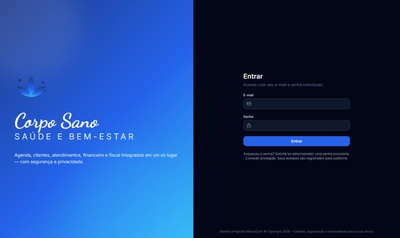
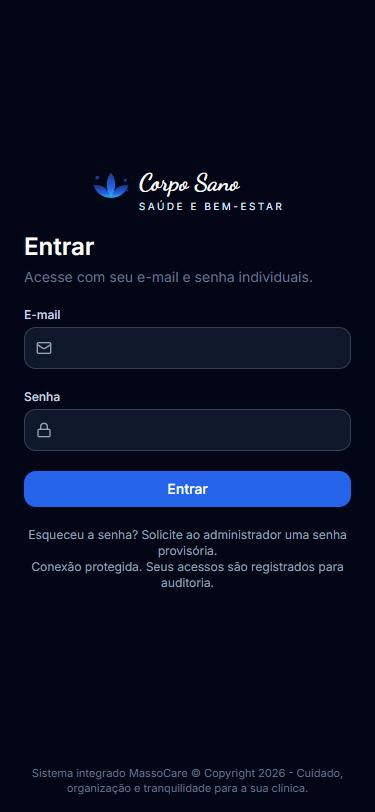

# Corpo Sano — Sistema de gestão para clínica de massoterapia

[](https://github.com/lbranquinho/corpo-sano-portfolio/actions/workflows/ci.yml)


> **Projeto de portfólio.** O código está público apenas para apresentação.
> Todos os direitos são reservados (veja [LICENSE](LICENSE)).

O **Corpo Sano** é um sistema web completo que está **em produção** numa clínica de
massoterapia. Ele reúne agenda, clientes, atendimentos, pacotes, financeiro e
emissão de nota fiscal num só lugar. Pode ser usado pelo navegador, instalado no
celular como app (PWA) ou instalado num computador Windows da clínica, sem internet.

<p align="center">
  
  &nbsp;
  
</p>

## Destaques

- **Agenda inteligente.** Detecta conflitos de horário por profissional e por sala de duas formas: na aplicação e por restrição de exclusão no PostgreSQL. Também respeita o intervalo entre sessões, o horário de funcionamento e a disponibilidade de cada profissional.
- **Pacotes de sessões.** Controla o saldo de cada pacote, a validade e as regras de falta e de cancelamento tardio. A tela mostra o percentual de desconto calculado em relação ao preço avulso.
- **Financeiro.** Separa o contratado, o recebido e o pendente. Registra estornos, faz o fechamento de caixa e gera relatórios em PDF, CSV e XLSX.
- **NFS-e Nacional.** Monta a DPS conforme o leiaute oficial, assina em XMLDSig com certificado A1 e se comunica por mTLS ICP-Brasil. Antes de emitir em produção, passa por uma etapa de prontidão: certificado válido, códigos de serviço, validação do contador e testes em homologação.
- **WhatsApp Business (API oficial da Meta).** Envia confirmações e lembretes por meio de modelos de mensagem aprovados. Usa fila com novas tentativas e webhook com assinatura HMAC, respeita o opt-out ("SAIR") e só envia com o consentimento do cliente.
- **LGPD e segurança.**
  - Dados de saúde criptografados com rotação de chaves, além de perfis e permissões granulares.
  - Trilha de auditoria, bloqueio por tentativas de login e sessão com expiração por inatividade.
  - Token de acesso só em memória; o refresh token fica em cookie httpOnly e é trocado a cada uso.
- **Backups.** Os backups diários são criptografados com AES-256-GCM e enviados para fora do servidor (S3 compatível). A restauração é testada automaticamente.
- **Responsivo e instalável.** Funciona no celular como app (PWA), com ícone na tela de início. O service worker **nunca** guarda dados da API no aparelho.

## Tecnologias

| Camada | Tecnologia |
|---|---|
| Frontend | React 18, TypeScript, Tailwind CSS, Vite, React Query, Recharts, PWA |
| Backend | Python 3.12, FastAPI, Pydantic v2, SQLAlchemy 2, Alembic, worker de tarefas |
| Banco | PostgreSQL 16 (56 tabelas, migrations versionadas, restrições de exclusão por intervalo) |
| Infraestrutura | Docker Compose, Nginx (HTTPS com Let's Encrypt), AWS EC2 com Systems Manager, GitHub Actions |
| Integrações | Sefin Nacional/ADN (NFS-e), WhatsApp Business Cloud API, armazenamento S3 compatível |
| Instalação local | Instalador Windows (Inno Setup) com Python e PostgreSQL embutidos e serviços do Windows |

## Arquitetura

```
Navegador / app (PWA) ──HTTPS──▶ Nginx ──▶ API FastAPI ──▶ PostgreSQL
                                   │            │
                                   │            └──▶ Worker: fila do WhatsApp, lembretes, backups
                                   └── arquivos do frontend (React)

Integrações externas: NFS-e Nacional (mTLS) · WhatsApp Cloud API · armazenamento S3 (backups)
```

```
backend/            API FastAPI, worker, migrations (alembic/) e testes (tests/)
  app/api/          rotas REST por módulo
  app/services/     regras de negócio (agenda, financeiro, fiscal, CRM, pacotes, backups...)
  app/integrations/ adaptadores externos (nfse/, whatsapp/)
  app/models/       modelos SQLAlchemy
frontend/           SPA React (páginas em src/pages, componentes em src/components)
installer/          instalador Windows
nginx/              configuração do proxy (HTTPS e local)
scripts/            chaves, certificado, backup, restauração, empacotamento
docs/               documentação técnica e manual do usuário
```

## Qualidade

**67 testes automatizados** rodam a cada commit no GitHub Actions e cobrem as regras críticas:
- autenticação e permissões;
- conflitos de agenda;
- pacotes e financeiro, incluindo estornos e fechamento de caixa;
- emissão fiscal: duplicidade, assinatura validada com libxmlsec1 e autorização só com confirmação oficial;
- WhatsApp: consentimento, novas tentativas e webhook assinado;
- criptografia de dados de saúde;
- backup e restauração reais com `pg_dump`/`pg_restore`.

## Documentação

- [Arquitetura, regras de negócio e testes](docs/ARQUITETURA.md)
- [Segurança e LGPD](docs/SEGURANCA_LGPD.md)
- [Configuração fiscal (NFS-e Nacional)](docs/CONFIGURACAO_FISCAL.md)
- [Configuração do WhatsApp Business Cloud API](docs/CONFIGURACAO_WHATSAPP.md)
- [Backup e restauração](docs/BACKUP_E_RESTAURACAO.md)
- [Implantação em servidor](docs/IMPLANTACAO.md) · [Instalador Windows](docs/INSTALADOR_WINDOWS.md)
- [Manual do usuário](docs/MANUAL_DO_USUARIO.md)

## Autor

**Leandro Branquinho** — [github.com/lbranquinho](https://github.com/lbranquinho)

## Licença

© 2026 Leandro Branquinho. **Todos os direitos reservados.** O código está visível só para
avaliação: não pode ser copiado, modificado, redistribuído nem usado comercialmente sem
autorização por escrito. "Corpo Sano" é marca de seu titular, usada aqui com autorização.
Veja [LICENSE](LICENSE).
